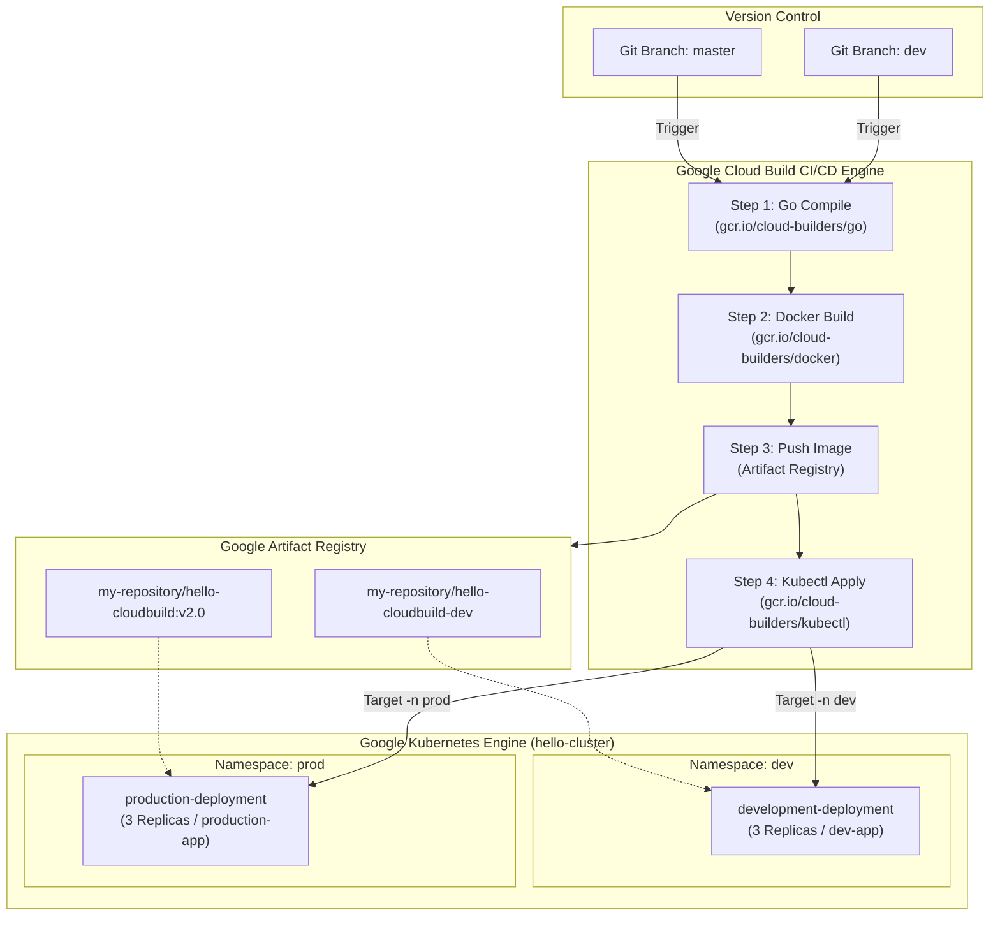

# Cloud-Native Go Microservice with Multi-Environment GKE CI/CD

[](https://golang.org)
[](https://github.com/GoogleContainerTools/distroless)
[](https://kubernetes.io)
[](https://cloud.google.com/build)
[](https://cloud.google.com/artifact-registry)
[](LICENSE)

A cloud-native microservice architecture demonstrating secure containerization, automated Google Cloud Build CI/CD pipelines, and multi-environment deployment orchestration on Google Kubernetes Engine (GKE).

---

## Table of Contents

- [Project Overview](#project-overview)
- [Key Architectural Highlights](#key-architectural-highlights)
- [Technology Stack](#technology-stack)
- [Repository Structure](#repository-structure)
- [System Architecture & CI/CD Workflow](#system-architecture--cicd-workflow)
- [Technical Deep Dive](#technical-deep-dive)
  - [1. Go Microservice Implementation](#1-go-microservice-implementation)
  - [2. Secure Multi-Stage Containerization](#2-secure-multi-stage-containerization)
  - [3. Continuous Integration & Delivery Pipelines](#3-continuous-integration--delivery-pipelines)
  - [4. Kubernetes Orchestration & Environment Isolation](#4-kubernetes-orchestration--environment-isolation)
- [Getting Started & Local Execution](#getting-started--local-execution)
  - [Prerequisites](#prerequisites)
  - [Clone & Setup](#clone--setup)
  - [Building and Running via Docker](#building-and-running-via-docker)
  - [Verifying the Endpoints](#verifying-the-endpoints)
- [Codebase Navigation Guide](#codebase-navigation-guide)
- [Engineering & Security Practices](#engineering--security-practices)
- [Roadmap & Production Enhancements](#roadmap--production-enhancements)
- [Author & Connect](#author--connect)

---

## Project Overview

This repository showcases an end-to-end cloud-native engineering pattern: building, packaging, verifying, and deploying a Go HTTP microservice across isolated development and production environments on Google Cloud Platform (GCP).

### Core Capabilities Demonstrated
- **Zero-Dependency Microservice**: High-throughput Go HTTP server utilizing the standard library for dynamic 2D RGBA image synthesis and stream encoding.
- **Hardened Multi-Stage Containerization**: Minimal image footprints using `golang:1.19.2` for static compilation and Google's `gcr.io/distroless/base-debian11` runtime to eliminate attack surface.
- **Automated Cloud CI/CD Pipelines**: Branch-aligned Google Cloud Build pipelines handling compilation, containerization, image tagging, Artifact Registry push, and Kubernetes deployment.
- **Environment Parity & Isolation**: Strict declarative separation between `dev` and `prod` environments on Google Kubernetes Engine (GKE) via dedicated namespaces and replica sets.

---

## Key Architectural Highlights

| Feature | Technical Implementation | Engineering Benefit |
| :--- | :--- | :--- |
| **Runtime Security** | `gcr.io/distroless/base-debian11` + `nonroot:nonroot` UID | Eliminates shells, package managers, and root attack vectors. |
| **Static Binary Linking** | `CGO_ENABLED=0 GOOS=linux` | Produces standalone binaries without runtime OS library dependencies. |
| **Pipeline Automation** | GCP Cloud Build YAML configurations | Eliminates manual deployments with reproducible build stages. |
| **Namespace Isolation** | Kubernetes Deployments partitioned into `dev` and `prod` | Enforces environment segregation and independent release cycles. |
| **High Availability** | 3-replica declarative deployments | Ensures fault tolerance and rolling-update stability. |

---

## Technology Stack

### Backend & Core
- **Language**: [Go (Golang)](https://golang.org/) (Standard Library: `net/http`, `image`, `image/color`, `image/draw`, `image/png`)
- **Execution Target**: Port `8080` (HTTP)

### Containerization & Infrastructure
- **Container Engine**: [Docker](https://www.docker.com/) (Multi-stage build)
- **Base Images**: `golang:1.19.2` (build stage), `gcr.io/distroless/base-debian11` (production runtime)
- **Container Registry**: [Google Artifact Registry](https://cloud.google.com/artifact-registry)
- **Orchestration**: [Kubernetes](https://kubernetes.io/) (GKE `hello-cluster` in `us-east1-c`)
- **CI/CD Automation**: [Google Cloud Build](https://cloud.google.com/build)

---

## Repository Structure

```text
.
├── cloudbuild-dev.yaml     # CI/CD pipeline definition for development environment
├── cloudbuild.yaml         # CI/CD pipeline definition for production environment
├── Dockerfile              # Production-grade multi-stage container build
├── main.go                 # Core Go HTTP web server and raster image generation
├── dev/
│   └── deployment.yaml     # Kubernetes Deployment manifest for 'dev' namespace
└── prod/
    └── deployment.yaml     # Kubernetes Deployment manifest for 'prod' namespace
```

### Directory & File Responsibilities

- [`main.go`](main.go): The entry point for the microservice. Sets up HTTP routing on port `8080` and dynamically generates PNG responses using Go's in-memory image primitives.
- [`Dockerfile`](Dockerfile): Implements a secure two-stage container build pattern. Compiles a statically linked Go binary and executes it inside a distroless container as an unprivileged user (`nonroot`).
- [`cloudbuild.yaml`](cloudbuild.yaml): Production CI/CD workflow. Compiles Go source code, builds tagged Docker image `hello-cloudbuild:v2.0`, pushes to Artifact Registry, and deploys to the `prod` Kubernetes namespace.
- [`cloudbuild-dev.yaml`](cloudbuild-dev.yaml): Development CI/CD workflow. Handles compilation, builds development container image `hello-cloudbuild-dev:<version>`, and deploys to the `dev` Kubernetes namespace.
- [`dev/deployment.yaml`](dev/deployment.yaml): Declarative Kubernetes Deployment for the development environment running 3 replicas labeled `app: dev-app`.
- [`prod/deployment.yaml`](prod/deployment.yaml): Declarative Kubernetes Deployment for the production environment running 3 replicas labeled `app: production-app` mapped to the release image.

---

## System Architecture & CI/CD Workflow

The following diagram illustrates how changes flow through code compilation, containerization, and automated deployment across Kubernetes environments:



---

## Technical Deep Dive

### 1. Go Microservice Implementation

Located at [`main.go`](main.go), the service provides two endpoints serving in-memory generated PNG images without reading files from disk:

- **Routing**: Configured via `http.HandleFunc` on port `8080`.
- **Dynamic Image Synthesis**:
  - `redHandler`: Initializes a 100x100 `image.RGBA` canvas, fills it with solid red (`color.RGBA{255, 0, 0, 255}`) using `image/draw`, sets `Content-Type: image/png`, and streams the encoded PNG payload directly to `http.ResponseWriter`.
  - `blueHandler`: Operates symmetrically to generate and stream a 100x100 solid blue (`color.RGBA{0, 0, 255, 255}`) PNG canvas.

```go
func redHandler(w http.ResponseWriter, r *http.Request) { 
    img := image.NewRGBA(image.Rect(0, 0, 100, 100)) 
    draw.Draw(img, img.Bounds(), &image.Uniform{color.RGBA{255, 0, 0, 255}}, image.ZP, draw.Src) 
    w.Header().Set("Content-Type", "image/png") 
    png.Encode(w, img) 
}
```

### 2. Secure Multi-Stage Containerization

Located at [`Dockerfile`](Dockerfile), the container build emphasizes security and operational efficiency:

```dockerfile
# Stage 1: Static Binary Compilation
FROM golang:1.19.2 as builder
WORKDIR /app
RUN go mod init hello-app
COPY *.go ./
RUN CGO_ENABLED=0 GOOS=linux go build -o /hello-app

# Stage 2: Hardened Distroless Runtime
FROM gcr.io/distroless/base-debian11
WORKDIR /
COPY --from=builder /hello-app /hello-app
ENV PORT 8080
USER nonroot:nonroot
CMD ["/hello-app"]
```

- **CGO Disabled (`CGO_ENABLED=0`)**: Creates a purely static Linux binary with no dependencies on host C libraries (`glibc`/`musl`).
- **Distroless Base Image**: Replaces heavy OS distributions with `gcr.io/distroless/base-debian11`, containing only minimal SSL certificates and tzdata. Shells (`/bin/sh`, `/bin/bash`) and package managers (`apt`, `dpkg`) are absent, mitigating common container breakout attacks.
- **Non-Root Execution**: Runs under UID `nonroot:nonroot`, adhering to Kubernetes security pod standards.

### 3. Continuous Integration & Delivery Pipelines

Automated via [`cloudbuild.yaml`](cloudbuild.yaml) (Production) and [`cloudbuild-dev.yaml`](cloudbuild-dev.yaml) (Development):

1. **Step 1 (`gcr.io/cloud-builders/go`)**: Compiles the Go binary inside the build worker.
2. **Step 2 (`gcr.io/cloud-builders/docker`)**: Packages the application into an OCI container image tagged for Google Artifact Registry (`us-east1-docker.pkg.dev/$PROJECT_ID/my-repository/...`).
3. **Step 3 (`gcr.io/cloud-builders/docker`)**: Authenticates and pushes the image to Artifact Registry.
4. **Step 4 (`gcr.io/cloud-builders/kubectl`)**: Uses the Kubernetes builder to authenticate with GKE cluster `hello-cluster` in region `us-east1-c` and execute `kubectl apply` against the specified namespace (`dev` or `prod`).
5. **Log Streaming**: Configured with `logging: CLOUD_LOGGING_ONLY` to stream build metrics directly to Google Cloud Logging.

### 4. Kubernetes Orchestration & Environment Isolation

Located in [`dev/deployment.yaml`](dev/deployment.yaml) and [`prod/deployment.yaml`](prod/deployment.yaml):

- **Declarative Workload Management**: Standard `apps/v1` `Deployment` specifications targeting 3 replicas for uninterrupted request handling.
- **Targeted Label Selectors**:
  - Development pods: `app: dev-app`
  - Production pods: `app: production-app`
- **Port Alignment**: Pod container port aligns with `ENV PORT 8080` in the application container.

---

## Getting Started & Local Execution

### Prerequisites

To build and run this project locally, ensure you have:
- [Docker](https://docs.docker.com/get-docker/) installed and running.
- *(Optional)* [Go 1.19+](https://golang.org/dl/) if running directly without containers.
- *(Optional)* [kubectl](https://kubernetes.io/docs/tasks/tools/) and a Kubernetes cluster (e.g. Minikube, Kind, or GKE).

### Clone & Setup

```bash
git clone https://github.com/tapan2004/sample-app.git
cd sample-app
```

### Building and Running via Docker

Build the multi-stage container image locally:

```bash
docker build -t hello-app:local .
```

Run the container, mapping container port `8080` to local port `8080`:

```bash
docker run --rm -p 8080:8080 hello-app:local
```

### Verifying the Endpoints

Once the container is running, query the image endpoints:

```bash
# Request the red image
curl -I http://localhost:8080/red

# Request the blue image
curl -I http://localhost:8080/blue
```

**Expected HTTP Response Header:**
```http
HTTP/1.1 200 OK
Content-Type: image/png
Date: Mon, 24 Nov 2026 16:30:00 GMT
Content-Length: ...
```

You can save the image to verify output:
```bash
curl -o red.png http://localhost:8080/red
curl -o blue.png http://localhost:8080/blue
```

---

## Codebase Navigation Guide

For engineers and evaluators exploring this repository, the recommended path of study is:

1. **[`main.go`](main.go)**: Review how the HTTP handlers and standard library image packages are wired.
2. **[`Dockerfile`](Dockerfile)**: Examine the build stages, compiler flags (`CGO_ENABLED=0`), and security context (`nonroot`).
3. **[`dev/deployment.yaml`](dev/deployment.yaml)** & **[`prod/deployment.yaml`](prod/deployment.yaml)**: Compare the declarative deployment manifests between environments.
4. **[`cloudbuild-dev.yaml`](cloudbuild-dev.yaml)** & **[`cloudbuild.yaml`](cloudbuild.yaml)**: Inspect how Cloud Build steps chain compilation, image publishing, and deployment.

---

## Engineering & Security Practices

- **Zero Third-Party Attack Surface**: The microservice relies solely on Go's standard library, avoiding vulnerable external dependencies.
- **Static Analysis & Reproducibility**: The multi-stage Docker build guarantees build hermeticity regardless of host operating system or local Go configurations.
- **Principle of Least Privilege**: Avoids running as root inside containers; uses `USER nonroot:nonroot` in the runtime layer.
- **Immutability**: Releases in production use distinct version tags (e.g., `:v2.0`) in Google Artifact Registry rather than mutable `:latest` tags.
- **Environment Isolation**: Separate namespaces (`dev` vs `prod`) ensure development updates cannot inadvertently impact production workloads.

---

## Roadmap & Production Enhancements

- [x] Lightweight Go HTTP microservice with standard library raster graphics.
- [x] Multi-stage build targeting distroless container runtime.
- [x] Cloud Build CI/CD automation for multi-stage deployment.
- [x] Kubernetes deployment manifests for `dev` and `prod` namespaces.
- [ ] **Kubernetes Services & Ingress**: Add ClusterIP Service manifests and Ingress with TLS termination.
- [ ] **Dynamic Version Substitution**: Parameterize container tags in `cloudbuild-dev.yaml` and `dev/deployment.yaml` using Cloud Build substitution variables (`$SHORT_SHA` / `$BUILD_ID`).
- [ ] **Configuration Management**: Introduce [Kustomize](https://kustomize.io/) or [Helm](https://helm.sh/) to manage environment overlays cleanly.
- [ ] **Observability**: Add Prometheus health checks (`/healthz`, `/ready`) and OpenTelemetry metrics.

---

## Author & Connect

**Tapan Manna**
- GitHub: [@tapan2004](https://github.com/tapan2004)
- Repository: [tapan2004/sample-app](https://github.com/tapan2004/sample-app)

---

## License

This project is licensed under the Apache License 2.0. See individual source file headers for license details.

